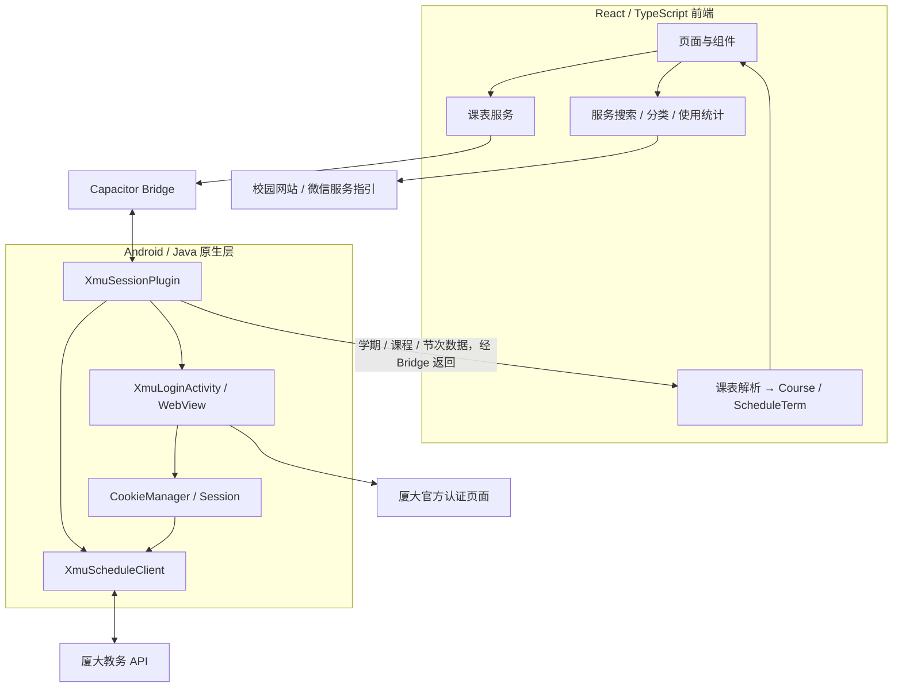

# 厦大校园 Hub · XMU Campus Hub

面向厦门大学学生的校园服务聚合与个人课表 App，支持 Web 访问与 Android APK。

**[下载 Android APK](https://github.com/human-ego/XMU-Campus-Hub/releases/download/v0.1.0-debug/app-debug.apk)** · Android 7.0+ · Debug 测试版

## 技术栈

| 层级 | 技术 |
| --- | --- |
| 前端 | React 19 · TypeScript · Vite 7 · Tailwind CSS 4 · Lucide React |
| Android | Capacitor 8 · Java · Android WebView · Gradle |
| 认证与数据 | CookieManager / Session 管理 · 自定义 Capacitor 插件 · 教务 API · TypeScript 课表解析 |

## 核心功能

- **校园服务聚合**：整合教务、选课、图书馆等 10 个入口，支持分类、关键词搜索与常用服务排序。
- **个人课表**：通过厦大官方页面登录，读取学期、课程与节次时间；支持按周切换、刷新及教师、教室展示。
- **复杂周次解析**：支持周次位图、单双周、连续与非连续周次，以及跨节课程、多教师和多教室信息。
- **微信服务指引**：提供场馆预约、快递与宿舍热水入口，按服务类型展示授权链接、小程序名称或二维码。

## 项目架构

采用 **React 前端 + Capacitor 桥接 + Android 原生能力** 的混合应用架构，无独立业务后端；服务导航与个人课表两条业务链路分离。



- **展示与业务分离**：`pages / components` 负责界面，`services` 封装调用，`lib/xmuScheduleParser.ts` 将教务数据转换为统一课程模型。
- **原生认证与数据访问**：WebView 完成官方认证，`CookieManager` 管理会话，Java 客户端复用登录态读取教务数据。
- **受限桥接接口**：`XmuSessionPlugin` 仅提供登录、会话验证、课表读取与会话清理，不向 React 暴露 Cookie 或 Token。

## 本地运行

需要 Node.js 22+；Android 构建另需 JDK 21、Android SDK 36，并配置 JAVA_HOME 与 SDK 路径。

```bash
npm ci
npm run dev          # 启动 Web
npm run build        # 类型检查与生产构建
```

构建 Android Debug APK（Windows）：

```bash
npm run cap:sync     # 构建并同步 Web 资源
npm run android:debug
```

APK 输出：`android/app/build/outputs/apk/debug/app-debug.apk`。

## 项目状态

目前处于开发与真机测试阶段，已提供 Debug 安装包。真实课表读取依赖 Android 原生能力与学校教务接口；Web 端提供服务导航与界面展示。微信小程序通过指引打开，不支持一键直跳。

本项目为非官方校园工具，无业务后端。密码与验证码在学校官方页面输入，服务使用统计保存在本地；教务接口变化可能影响课表读取。
